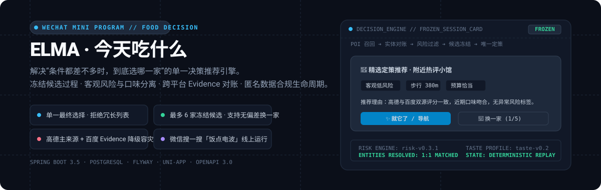
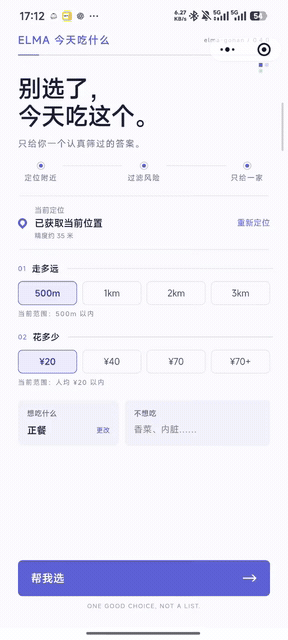

# ELMA · 今天吃什么

<div align="center">
  
</div>

<p align="center">
  <strong>微信搜一搜小程序：饭点电波</strong>
</p>

<p align="center">
  <a href="#产品实际操作与演示"><strong>产品演示</strong></a> ·
  <a href="#四个关键架构设计点"><strong>核心机制</strong></a> ·
  <a href="#数据流转链路"><strong>决策链路</strong></a> ·
  <a href="#技术栈与本地启动"><strong>本地运行</strong></a> ·
  <a href="#当前边界与非目标"><strong>设计边界</strong></a>
</p>

---

ELMA（今天吃什么）是一个帮助用户从附近餐厅中快速做出就餐决定的微信小程序。

它解决的核心痛点不是“附近有哪些餐厅”，而是“在候选餐厅条件都差不多时，到底去哪一家”。用户设定距离范围、人均预算、菜系品类以及不想吃的内容，服务端完成多源信息聚合与风险过滤后，**最终仅返回一个主要推荐结果**。若用户不满意，可在同一轮冻结候选池中无偏切换（最多 5 次换一家），并通过反馈逐步沉淀后续推荐画像。

---

## 产品实际操作与演示

<div align="center">
  
  <p><sub>从条件筛选到推荐结果与按需深挖</sub></p>
</div>

<div align="center">
  
  <p><sub>微信搜一搜“饭点电波”即可直接体验小程序</sub></p>
</div>

### 典型用户交互链路
1. **授予位置权限**：按需调整搜索半径（如 500m / 1km）、预算区间、菜系标签和“不想吃”的负向偏好；
2. **查阅唯一推荐**：查看系统定策选出的一家餐厅，阅读推荐理由、客观风险评估标签以及跨平台信息摘要；
3. **做出明确行动**：直接确认“就它了”唤起系统地图导航，或者在最多 5 个预计算备选中“换一家”；
4. **提交反馈或深挖**：提交三态评价（满意 / 一般 / 不行）与口味标签；需要时主动点击“深挖一下”查看全网公开讨论摘要；亦可随时彻底注销匿名身份并物理清除关联数据。

---

## 四个关键架构设计点

### 1. 一次推荐是一段冻结的确定性决策过程
高德 POI 在经历餐饮身份校验、硬条件过滤、跨平台风险评估与个性化排序后，在内存中生成最多 6 家候选集合。候选名单、分项权重得分、随机数种子以及选择前快照均在服务端原子化持久化。用户点击“换一家（reroll）”时直接读取已冻结的候选快照，绝不触发重新查询或二次排序，确保决策过程可回溯、不飘移。

### 2. 餐厅客观风险与用户主观口味彻底解耦建模
- **客观风险模型 (`risk-v0.3.1`)**：仅衡量餐厅本身的客观资质与数据完整度（营业状态真实性、跨平台评分反差、负面评论密度）；
- **用户偏好画像 (`taste-v0.2`)**：仅从用户的显式反馈、轻量交互行为以及近期饮食历史推算偏好权重。
用户不喜欢某家餐厅的菜系，只会降低该品类在其个人画像中的权重，绝不会将该门店标记为“客观高风险”，两套状态机在领域模型上严格隔离。

### 3. 第二数据源作为可降级的结构化证据（Evidence）
高德开放平台作为主餐厅数据源，百度地图仅作为可平滑降级的辅助证据源。系统通过门店名称、GPS 物理坐标、门牌地址与联系电话进行一对一跨平台实体对齐（Entity Resolution）；在无匹配、存在歧义或外部百度服务故障时，主推荐流程平稳继续，不让辅助数据源的不可用拖垮核心链路。

### 4. 匿名体系下的完整数据生命周期管理
小程序不强制要求手机号登录，客户端首次启动生成匿名 UUID 并由服务端签发凭据。项目提供透明的隐私政策与符合合规要求的数据注销接口（`DELETE /api/v1/users/me/data`）。用户申请清除时，服务端按外键级联物理删除关联的推荐历史、行为记录与口味画像，同时安全保留不属于个人隐私的公共餐厅库与 POI 证据。

---

## 数据流转链路

```text
附近高德 POI 检索召回
  │
  ▼
餐饮资质校验与用户硬条件过滤 (排除商场/写字楼等误标 POI)
  │
  ▼
跨平台实体匹配与结构化 Evidence 聚合 (百度数据双重对账)
  │
  ▼
质量 / 客观风险 / 口味偏好 / 预算距离 / 近期多样性 综合评分
  │
  ▼
硬性熔断剔除 HIGH 风险门店 (低风险阈值内的受限探索)
  │
  ▼
冻结生成最多 6 家优质候选 (固化随机种子与分项得分)
  │
  ▼
输出首屏唯一确定性推荐 (支持最多 5 次等权 reroll)
```

系统保存排序前快照与随机种子，确保任意一次线上推荐均可复盘定位，杜绝无法解释的黑盒推荐。

---

## 核心工程模块映射

- `RecommendationService`：核心门面服务，编排 POI 召回、过滤、Evidence 校验、风险评分、候选冻结与反馈链路；
- `DefaultRecommendationEngine`：负责高风险熔断剔除、加权排序、有限探索算法与确定性候选重放；
- `EvidenceAggregator` / `EntityResolver`：跨地图平台的实体对齐、多级模糊匹配、缓存管理与优雅降级；
- `TasteProfileService` / `BehaviorService`：处理用户显式反馈、幂等交互记录与长期偏好画像收缩；
- `DeepEvidenceService`：当用户主动触发“深挖一下”时，通过合规公开索引检索第三方平台弱线索摘要；
- `UserDataDeletionService`：负责匿名用户数据合规注销与级联清除；
- `contracts/openapi.yaml`：前后端通信契约事实源，严格驱动接口开发与自动化测试。

---

## 技术栈与本地启动

### 技术栈选型
- **前端小程序**：uni-app、Vue 3、TypeScript、Pinia、Vitest；
- **后端服务**：Java 17、Spring Boot 3.5、Spring Data JPA、Flyway 数据库版本迁移；
- **存储与缓存**：PostgreSQL 15+、Caffeine 高性能进程内缓存；
- **外部地图集成**：高德 Web 服务 API、百度 Place API、百度 AI 检索；
- **工程契约与测试**：OpenAPI 3.0、JUnit 5、Vitest 跨端自动化。

### 本地快速运行

#### 1. 前端小程序构建
前端环境要求：Node.js 22 与 pnpm 11+。

```bash
cd /path/to/elma-gohan
pnpm install
cp .env.example .env.local
pnpm dev:mp-weixin
```

构建完成后，在微信开发者工具中导入产物目录 `dist/dev/mp-weixin` 即可。

#### 2. 后端 API 服务启动
要求：JDK 17 与 PostgreSQL。

```bash
mvn -f backend/pom.xml spring-boot:run
```

所有第三方 API 密钥与数据库账号密码均严格通过环境变量注入，详见 [`backend/README.md`](backend/README.md)。

---

## 质量验证

执行全套自动化检验流水线：

```bash
# 前端类型检查与自动化测试
pnpm typecheck
pnpm test:run
pnpm build:mp-weixin

# OpenAPI 规范契约语法校验
python3 contracts/validate_openapi.py

# 后端全量测试套件 (包含推荐边界、候选重放、实体对齐与注销接口)
mvn -f backend/pom.xml test
```

---

## 当前边界与非目标

1. **规则驱动而非深度学习**：推荐、风险评估与画像更新均为显式透明的规则算法，暂未引入神经网络黑盒模型，亦未进行线上大规模 A/B 流量实验；
2. **匿名归属不跨设备**：客户端匿名 UUID 仅用于单设备数据连续性，不支持跨设备云端漫游；
3. **跨平台对齐阈值保护**：实体对齐严格依赖有限元数据匹配，在数据模糊时主动标记为“无第二来源证据”，避免强行拼合造成错误推荐；
4. **步行时间为距离估算**：推荐卡片中显示的步行时间基于曼哈顿/欧氏距离估算，非实时路网路径规划结果；
5. **外部 API 物理配额**：高德与百度开放平台存在每日调用配额限制，极端大流量下可能受第三方配额制约。
